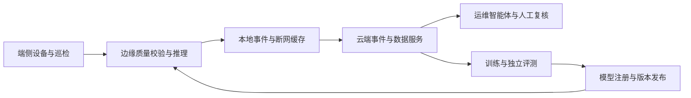

# 云边端与智能体协同路线

目标是让模型能从实验代码走向现场运维。当前训练、推理和报告均在本机运行；本文为后续开发设计，不代表已经接通电站、部署云端或实现设备控制。

## 分工

| 层级 | 职责 | 接口需要保留的信息 |
| --- | --- | --- |
| 端侧 | 采集逆变器、传感器和巡检终端观测 | 场站/设备 ID、采样时间、单位、质量标记、来源 |
| 边缘侧 | 质量校验、滚动窗口、本地推理、事件缓存、断网续传 | 模型版本、特征版本、事件 ID、序号、推理时间、原始证据引用 |
| 云端 | 数据版本、训练/评测、模型注册、发布与回滚、跨站分析 | 训练清单、评测范围、权重校验值、部署状态与回滚记录 |
| 运维智能体 | 调用查询/诊断工具、组织证据、整理建议与工单草稿 | 每步工具调用、引用、未知项、人工复核与处置历史 |

## 分阶段验收

1. **模型可部署**：保存完整输入规范、归一化参数及权重，完成本机 CPU 推理和权重加载一致性检查；再核实目标设备支持的 ONNX 等推理格式。
2. **边缘代理原型**：对文件回放源进行固定大小窗口推理，记录延迟、内存、丢样、缺测和重启恢复情况；不先接现场控制接口。
3. **消息同步**：定义观测和事件消息，验证身份、序号、幂等、断网队列、重复投递及时间乱序处理。
4. **云端模型管理**：实现模型评测门槛、权重校验、逐站发布、失败回滚与版本追踪。
5. **智能体协同**：只读查询和工具调用先行，再接入人工复核和工单草稿。数据或检索文本中的命令不作为执行授权。
6. **真实场站验证**：取得许可和设备协议，确认时区、测点、网络条件和硬件算力，再做现场试点。

当前独立的 `deep_model.py`、`train_deep.py` 和 `predict_deep.py` 是训练与推理解耦的起点。断网续传、云端模型注册、边缘推理服务、ONNX 导出与端侧协议接入尚待实现。
