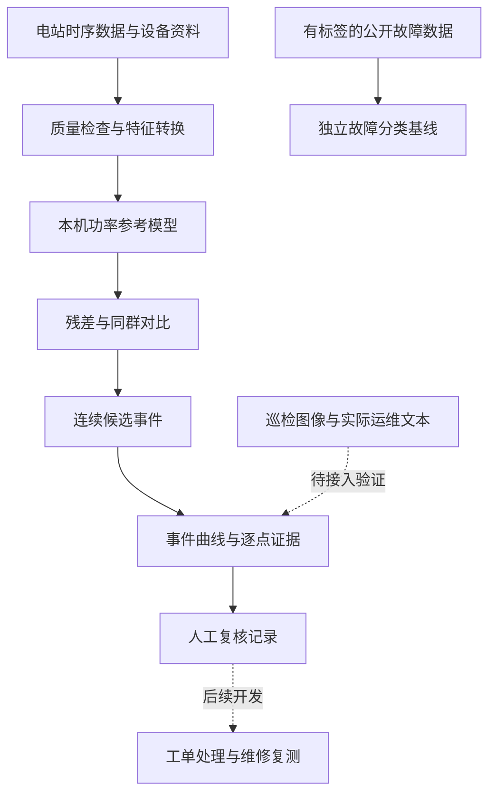

# 伏脉智维 Fumai Zhiwei

**面向光伏电站的设备异常筛查、故障辨识与数字化运维研究项目。**

**队友参与开发：先阅读 [代码协作要求与规范](CONTRIBUTING.md)。** 领取任务、创建分支、提交代码和交接实验都按这份约定执行；模型实验使用 [实验记录模板](docs/EXPERIMENT_TEMPLATE.md)。

这个项目想做的是：把电站的发电数据、设备状态和巡检信息整理起来，帮助运维人员找到“哪里可能出了问题”，展示判断依据，再记录人工排查和处理结果。

我们面向工创赛的**工程场景数字化赛道**开展研发。当前已经有能运行的模型基线和历史事件回放报告，正在向完整的运维原型推进。模型输出的候选异常还需要真实工单或现场检查来确认。

> **第一次看这个项目，可以先记住三件事：**
>
> 1. 我们关注的是光伏电站的日常运维：发现异常、辅助排查、跟踪处理。
> 2. 目前已经能读取历史数据、训练模型、筛查异常，并打开事件详情看曲线和证据。
> 3. 完整平台、实际维修闭环、跨电站验证和图像巡检还没有全部完成。当前结果不能直接当作现场故障结论。

## 1. 我们到底想解决什么问题？

光伏电站有很多块光伏板，也有很多台逆变器。光伏板把阳光转成直流电，逆变器再把直流电转换成可并网的交流电。

电站每天都会产生大量记录：什么时候发了多少电、太阳辐照有多强、温度和风速是多少、设备有没有告警等。运维人员需要从这些记录中判断：

- 发电少，是因为天气变差，还是某台设备掉队了？
- 某台设备功率为零，是正常检修、停机、通信问题，还是设备故障？
- 哪些异常值得优先检查？判断依据是什么？
- 检查后发现了什么，处理后有没有恢复？

单独看一个功率数字，通常回答不了这些问题。我们的目标是把**数据、模型、判断证据和人工处置记录**联系起来，形成可以追溯的运维过程。

### 用一个例子理解

假设中午天气正常，模型根据当时的辐照和温度，估计某台逆变器通常应该发出约 25 kW，而实际只有 2 kW。

系统会继续比较其他同类设备：

- 如果其他设备都正常，只有这一台明显偏低，就把它列为“单机偏离同群”的候选事件。
- 如果很多设备同时下降，就保留为“同群共性或模型偏差”候选，需要核对限发、传感器、场站运行状态等信息。
- 如果数据缺失或可比较的设备不足，就明确标出证据不足。

这些结果提供排查线索。它们不能仅凭功率曲线就确定“逆变器坏了”或“组件发生了某种故障”。

## 2. 项目的目标是什么？

### 总体目标

做出一个面向光伏场站的数字化运维原型，让使用者能够完成：

**看数据 → 找异常 → 看依据 → 做复核 → 记录处理 → 检查恢复情况。**

最终希望交付的内容包括：

| 交付内容 | 它能帮助使用者做什么 | 当前进展 |
| --- | --- | --- |
| 数据处理与质量检查 | 知道数据有哪些字段、缺失和冲突，避免直接用错误数据判断 | 已有时序数据审计和 2107 数据适配 |
| 异常筛查模块 | 从大量设备记录中筛出值得关注的时段 | 已有功率残差与同群对比筛查 |
| 故障辨识模块 | 在数据和标签适用时，给出故障类别线索 | 已有独立公开数据上的 DC 侧五分类基线 |
| 事件证据页面 | 查看异常前后曲线、阈值和逐点数据 | 已有本地离线报告和事件详情 |
| 人工复核与处置记录 | 保存人工判断及依据，并跟踪后续处理 | 已有命令行复核和历史记录；工单、维修与复测流程待开发 |
| 展示与验证材料 | 向队友、老师和评委说明系统怎么工作、效果如何 | 已有可运行报告；完整演示平台和独立效果验证待完善 |

### 研究目标

我们重点研究如何把**当时的天气条件、本机历史表现、同群设备表现和人工反馈**结合起来，让候选异常更容易解释和复核。

这一思路已经有初步代码实现，但是否比现有方法更有效，需要后续用真实标签、独立事件和其他电站数据进行比较。目前还不能宣称已经证明了算法创新或现场效果提升。

## 3. 五个研究方向分别是什么？

老师提供的文件汇总了多类公开数据及其适用场景。围绕这些场景，我们把项目工作理解为下面五个方向。**这五个方向不是五个已经全部完成的产品。**

| 方向 | 用通俗的话说 | 目前做到了什么 | 还缺什么 |
| --- | --- | --- | --- |
| 场站全流程运维 | 把设备数据、告警、工单和处理结果连起来 | 有候选事件、详情报告和人工复核记录 | 实际工单接入、任务流转、维修与复测闭环 |
| 设备故障识别与态势感知 | 判断设备是否异常、可能属于哪类问题 | 有功率异常筛查和 DC 侧五分类模型 | 本项目场站的确认故障标签、逆变器内部故障数据、跨站验证 |
| 发电性能、衰减与积尘分析 | 分析发电为什么变少、是否长期变差 | 有同一时刻功率参考和削顶检测调用 | 严格的长期衰减评估、积尘归因和清洗效果验证 |
| 时序数据与运维文本结合 | 把曲线和“发生过什么”的文字记录一起分析 | 已实现 OpenCEM 错位行隔离、文本规范化及时间关联 | 可用故障/工单标签、关联效果验证与模型训练 |
| 图像巡检与组件缺陷识别 | 从普通照片或红外图像里找组件问题 | 已训练红外裁图分类基线并完成一次跨来源检验；外部正常图像误报严重；整图缺陷目标检测尚未训练 | 改进分类跨域泛化，获取带缺陷框和正常整图的检测数据，补独立场站和现场复核标签 |

研发优先推进已有数据能支撑的部分：**时序异常筛查 → 证据解释 → 人工复核**。图像巡检和真实工单逐步接入。

## 4. 现在已经能运行哪些功能？

### 4.1 数据质量检查

代码会检查数据字段、缺失比例、重复键、时间范围和文件校验值。文件校验值可以理解为文件的“指纹”，用于确认两次实验是否用了相同的数据。

队友提供的 OpenCEM 分片中，发现一半测量记录的列数与表头不符，会导致字段错位。新增读取器会先隔离这些行，保留来源和原因，再对剩余数据检查重复键。相关数据没有自动用于故障训练，普通工作站日志也没有被当成故障标签。

### 4.2 24 台逆变器的功率参考模型

模型学习历史数据中的关系：在某种辐照、温度、风速和时间条件下，这台设备通常输出多少功率。

然后比较：

```text
功率残差 = 模型给出的参考功率 - 实际功率
```

残差持续偏大，说明实际表现比历史参考低，值得检查。

这里的“参考功率”使用**同一时刻的天气观测**。目前这项功能不预测明天发多少电，也不预测故障会提前几天发生。

### 4.3 同群对比与连续事件

系统比较本机和其他同群设备的“实测功率 / 本机参考功率”。这样可以先考虑各台设备不同的历史表现，再观察是否有某一台明显掉队。

当前规则要求：

- 功率残差连续至少 3 个采样点超限，才合并为候选事件。
- 相邻采样点间隔必须正好为 5 分钟；缺测、无效数据和分组变化会打断事件。
- 同群比较排除设备自身，至少需要 5 台其他有效设备。
- 本机比值低于其他同群中位数超过 0.20 时，记录同群偏离证据。这个阈值是待验证的工程规则。

3 个采样点之间的观测跨度是 10 分钟。当前暂定同群只用于 2107 场站，迁移到新场站时，需要重新确认设备配置、朝向和运行条件。

### 4.4 事件报告与详情页面

本地报告可以按设备、时间、证据和复核状态筛选候选事件。点击事件 ID，可以查看：

- 候选区间及前后各最多 60 分钟的已保留日间数据；
- 实测功率、参考功率和残差阈值曲线；
- 本机与其他同群设备的相对表现曲线；
- 每个采样点的数值、阈值、有效同群数量和触发标记；
- 复核说明和需要进一步核对的信息。

图中的缺测处会断开曲线，不把缺失时间画成连续观测。页面同时给出“参考电量差”，用于描述观测区间内实际功率与参考功率的差距，不能直接解释为维修后可以挽回的电量。

### 4.5 人工复核与待复核清单

系统会生成一份待复核清单，按证据类别和设备轮转选取，避免排查任务全挤在同一台设备上。目前默认最多 60 条，用于安排复核工作。

人工判断可以记录为：已确认故障、预期运行、数据问题或待进一步调查。每次修改追加历史，不覆盖之前的复核记录。

**这份清单用于排查，不是随机抽样的评估集，不能直接用它估计全站准确率。**人工复核也不会自动变成训练标签。

### 4.6 独立的 DC 侧五分类模型

另一个模型使用 Costa/Lazzaretti 公开的双组串数据，识别正常、组串短路、模拟退化、组串开路和遮挡。

“组串”可以理解为多块光伏组件串联形成的一组。这个模型识别的是该公开数据中的 DC 侧运行状态，尚不能直接用来判断队友电站的逆变器内部故障。

此外，项目已调用 RDTools 的公开预训练模型，完成削顶候选识别。削顶指功率在接近设备输出上限时被限制的现象，本身不必然是故障。

### 4.7 新增的 AI 分析

OpenCEM 分支已有两项自主训练的机器学习模型：

- **Isolation Forest 多变量异常检测**：一起观察电压、电流、荷电状态、光伏功率、负荷和温度，寻找偏离历史组合的观测。按时间先训练、再校准阈值、最后留出回放，避免用测试数据确定阈值。
- **TF-IDF + KMeans 文本聚类**：把活动描述转成数值特征，按用词相似性自动分组，并列出代表词。它整理的是活动记录，不是把文字直接判成光伏故障。

运行数据处理后，再训练这两项模型：

```bash
python src/opencem_ai.py
```

打开 `reports/opencem/ai.html` 查看模型说明、文本分组、留出异常候选点和该时刻已经可用的活动文本。

### 4.8 自主深度学习与领域预训练

新增自主实现的时序卷积编码器：先在训练数据上遮住一部分数值，让模型学习重建，再用五类标签微调。另训练相同结构的“从零训练”模型及同协议树模型，检查预训练是否带来提升。

首轮实验在本机 Apple GPU 上完成。按本轮统一的 75%/5%/20% 原始有序行划分、边界隔离与不重叠窗口，预训练后模型的测试准确率为 **99.37%**、宏平均 F1 为 **98.33%**；同协议树模型分别为 98.30% 和 96.81%。这是第一轮单种子结果，不能直接与前文不同协议的 96.01% 比较，也不能据此宣布超过 SOTA 或证明跨电站效果。

训练方法、严格划分、推理方式及后续多种子计划见 [深度学习研发说明](DEEP_LEARNING.md)。目标是建立自己的可复现强模型；对其他功能，也会在取得相应数据和标签后训练适用模型。

三种子复核现已完成：预训练后模型平均准确率 **99.55%**、宏平均 F1 **98.59%**；同协议树模型分别为 98.42% 和 96.96%。全部种子的结果与标准差见上述说明；单站测试与 SOTA 比较的限制仍然适用。

## 5. 我们用的是什么数据？

| 数据来源 | 内容和用途 | 当前使用情况 |
| --- | --- | --- |
| 队友提供的 PVDAQ 2107 文件 | 电气、辐照、环境和设备元数据 | 已用于 24 台逆变器功率参考与历史事件回放 |
| Costa/Lazzaretti 公开故障数据 | 双组串系统的电气量、环境量及五类标签 | 已下载并训练独立分类基线 |
| 队友提供的 OpenCEM 分片 | 微网测量和文本记录 | 已完成错位行隔离、文本规范化与可获得时间关联；仍缺故障真值 |
| 老师资料中推荐的国内运维、故障案例和图像数据 | 可支持实际工单、逆变器故障及巡检研究 | 资料提供了线索，不代表实际数据文件已经全部取得 |
| La Réunion 屋顶电站公开数据 | 故障逆变器带遮挡故障标签、对照逆变器及分开的气象记录 | 电气和气象数据已下载；已完成独立事件模型比较和气象增强对照，结果见时序实验报告 |
| PV-Fault-DS226 两组件实验数据 | 两个组件的电流、电压、辐照、温度及五类运行状态 | 已下载并做标签与功率质量审计；标签主要由输入电气量的规则生成，不能用它证明真实场站故障泛化 |
| SolarMagix 多场站运行数据 | 7 个电站、50 台逆变器的小时级发电、气象和运行状态 | 已下载并校验部分文件，拟用于跨场站时序预训练；状态码不等于经过人工确认的故障真值，异常字段需先过滤 |
| TECNALIA 组件性能公开数据 | 多种组件长时间电气和气象数据 | 已下载；当前文件没有逐行故障标签，先用于正常行为与跨组件稳健性分析 |
| RaptorMaps、SolarFCD、sUAS 红外图像 | 组件热异常、结构和表面问题图像 | 已下载并盘点；SolarFCD 的原始划分存在跨集合重复图像和标签冲突，不能直接用于可信测试 |
| ELPV 电致发光图像 | 电池片缺陷概率和 EL 图像 | 已下载；与无人机热红外属于不同成像任务，且其 CC BY-NC-SA 许可不适合直接用于商业产品 |

这些数据来自不同场站和任务，不能因为都与光伏有关，就直接混成一个训练集。目前用于主要功率回放的是海外公开场站数据，对国内实际场站的适用性仍需验证。

新发现和已下载的数据来源、许可、文件校验与适用范围持续记录在[公开数据集清单](DATASETS.md)。

**数据集已下载不等于模型已训练完成。**新获取的数据仍需做标签核查、按电站/组件分组、去重和独立测试；特别是 SolarFCD 原始划分存在重复与标签冲突，不能照搬其测试集结果。

原始数据、模型权重和本地报告放在本机，不随 GitHub 代码仓库上传。仓库包含数据下载脚本、处理和模型代码、说明文档及测试。

## 6. 当前结果应该怎么看？

### 功率筛查回放

使用 2022 年之前的数据训练功率参考模型，用 2022 年数据确定各台残差阈值，再在 2023 年留出数据上回放。

| 项目 | 当前结果 |
| --- | --- |
| 设备数 | 24 台逆变器 |
| 通过特征质量过滤的日间时刻 | 38,672 个 |
| 连续低发电候选事件 | 691 条 |
| 同时具有单机偏离同群证据 | 311 条 |
| 同群共性变化或模型偏差候选 | 380 条 |

**691 条是待检查的候选事件数量，不是已确认故障数量。**由于缺少真实故障标签，目前无法计算这些候选的故障识别准确率或误报率。

### 五分类基线

Costa/Lazzaretti 数据按原始有序行前 80% 训练、后 20% 测试，在边界两侧各隔离 100 行，并每 10 行抽样一次。本地第一轮结果为准确率 **96.01%**、宏平均 F1 **92.04%**。

准确率表示测试样本中有多少被分对；宏平均 F1 则让每种类别都参与平均，避免数量最多的正常样本掩盖其他类别的表现。

这些成绩只对应该单电站数据流后段测试。尚未验证跨电站、独立新故障事件或真实部署效果，不能当作我们整个系统的准确率。

### 遮挡故障时序模型

La Réunion 数据上比较了 ExtraTrees、自主多尺度 CNN 和轻量 Transformer，每个神经模型训练三个随机种子。按验证集 AP 选中的 Transformer，在后续独立故障事件测试中 AP 为 **0.734**，故障窗口召回率 **0.962**，但精确率只有 **0.579**；24 个无故障测试日期中有 10 天出现告警。数据只覆盖一座电站的人为遮挡实验，当前模型**不能用于生产自动告警**。详细划分、全部候选结果和误报分析见 [La Réunion 时序实验报告](docs/REUNION_EXPERIMENT.md)。

### 红外图像模型

在 Raptor Maps 公开红外图上训练了自主 CNN，并比较随机初始化和遮挡预训练。选中的三种子集成在同来源内部测试的 12 类准确率为 **0.835**、宏平均 F1 为 **0.706**。但不调模型和阈值迁移到 sUAS 红外图时，**2,835 张正常图中有 2,803 张误报**。这说明内部测试分数不能代表真实场站效果；图像模型仍处于研究阶段。协议、完整结果和局限见[红外图像实验报告](docs/INFRARED_EXPERIMENT.md)。

组件缺陷**目标检测**是另一项任务：它要在整幅巡检图上定位缺陷框，不能用上述裁图分类结果代替。时序、裁图分类、目标检测三条线的候选架构、统一比较方式和工业验收条件见[模型选择方案](docs/MODEL_SELECTION.md)。

## 7. 系统是怎么串起来的？



目前功率筛查链路和独立故障分类基线分别运行。两者没有被强行合并成一个能自动给出所有故障原因的模型。

## 8. 我只想先看看效果，该看哪里？

如果已经在这台开发机器上生成了报告，可以先打开：

```text
reports/replay/index.html
```

使用方法：

1. 在列表里筛选某台设备，例如 `inv_01`。
2. 点击事件 ID，进入详情。
3. 对照实测、参考和同群曲线，查看哪些采样点触发了规则。
4. 核对现场记录或工单，再保存人工判断。

这些页面是本地生成的 HTML，不要求连接云端服务。GitHub 仓库不包含本机生成的报告；其他人需要准备数据和运行代码后生成自己的报告。

## 9. 如何从零运行？

这一节面向负责部署和代码的队友。只想理解项目的人可以先跳过命令。

### 第一步：安装环境

建议使用 Python 3.12，在终端运行：

```bash
 git clone https://github.com/lheng2386-png/fumai-zhiwei.git
 cd fumai-zhiwei
 python3.12 -m venv .venv
 source .venv/bin/activate
 python -m pip install -r requirements-lock.txt
```

macOS 的 XGBoost 需要 OpenMP，可通过 `brew install libomp` 安装。

### 第二步：准备数据

将获准使用的 PVDAQ 2107 文件放在 `data/input/`：

```text
 data/input/
 ├── 2107_electrical_data.csv
 ├── 2107_irradiance_data.csv
 ├── 2107_environment_data.csv
 └── 2107_system_metadata.json
```

这些文件目前需要自行准备。代码中的 2107 适配器并不是任意电站 CSV 的通用导入器。

下载独立分类任务使用的公开故障数据：

```bash
python src/fetch_public_fault_data.py
```

### 第三步：训练基线并生成结果

```bash
python src/run_baselines.py --data-dir data/input
python src/check_pretrained_clipping.py --data-dir data/input
```

第一条命令会进行数据审计、训练功率参考模型和五分类模型，并把模型保存到 `models/`，结果保存到 `reports/`。这些 CPU 基线目前不需要云 GPU。

### 第四步：生成运维事件报告

```bash
python src/replay.py --data-dir data/input --start 2023-01-01 --end 2024-01-01
```

结束日期不包含在区间内。时间沿用场站本地墙上时钟 PST8PDT，不是中国标准时间。打开生成的 `reports/replay/index.html` 即可查看列表和详情。

| 输出文件 | 内容 |
| --- | --- |
| `reports/replay/index.html` | 事件总览和筛选入口 |
| `reports/replay/details/` | 每条事件的曲线与逐点证据页面 |
| `reports/replay/events.csv` | 候选事件汇总 |
| `reports/replay/evidence.csv` | 回放的逐点证据 |
| `reports/replay/review_queue.csv` | 待复核清单 |
| `reports/replay/summary.json` | 回放范围、筛查规则、输入与模型校验值 |

如果已经有 `events.csv` 和 `evidence.csv`，只想重新生成详情页面，可运行：

```bash
python src/event_details.py --replay-dir reports/replay
```

### 第五步：记录人工复核

从报告复制实际事件 ID，替换下面的 `EVENT_ID`，并填写实际排查说明：

```bash
python src/review.py --event-id EVENT_ID --status needs_investigation --note "填写需要进一步核实的现象和依据"
python src/replay.py --data-dir data/input --reviews-db reports/reviews.sqlite
```

| 命令中的状态值 | 含义 |
| --- | --- |
| `needs_investigation` | 还需要进一步调查 |
| `expected_operation` | 核实为预期运行，例如计划停机 |
| `data_issue` | 核实为测量、通信等数据问题 |
| `confirmed_fault` | 有实际依据确认发生故障 |

第二条命令把最新复核记录合入重新生成的报告。回放会覆盖报告文件，复核数据库保留历史。当前通过命令行记录复核，网页内填写和保存的交互尚未开发。

### 其他命令

使用已训练的 DC 侧分类器对 CSV 推理：

```bash
python src/predict_fault.py reports/fault_inference_sample.csv --output reports/fault_predictions.csv
```

运行测试：

```bash
python -m unittest discover -s tests -v
```

## 10. 代码放在哪里？

```text
fumai-zhiwei/
├── README.md                       项目入口说明
├── DEVELOPMENT.md                  研发记录、规则与验证范围
├── requirements-lock.txt           运行依赖及固定版本
├── src/
│   ├── fetch_public_fault_data.py  下载公开故障数据并校验
│   ├── power_data.py               2107 数据转换与特征准备
│   ├── run_baselines.py            审计、训练与基线评估
│   ├── predict_fault.py            DC 侧分类模型推理
│   ├── check_pretrained_clipping.py 调用削顶识别模型
│   ├── events.py                   同群证据与连续事件筛查
│   ├── replay.py                   加载已有模型进行历史回放
│   ├── event_report.py             生成事件总览
│   ├── event_details.py            生成曲线详情和待复核清单
│   ├── review.py                   保存人工复核及历史
│   ├── opencem.py                  OpenCEM 质量处理与活动文本关联
│   ├── opencem_ai.py               多变量异常检测与活动文本聚类
│   ├── deep_model.py               自主时序编码器与特征规范
│   ├── train_deep.py               掩码预训练、微调与同协议对照
│   ├── predict_deep.py             深度模型 CPU 推理
│   └── summarize_deep.py           多种子汇总与模型对照图
└── tests/                          筛查、证据页面和复核测试
```

`data/`、`models/`、`reports/` 是运行时目录，已设置为不纳入 Git 提交。

### 按老师资料推进的数据分支

五类数据场景、取得状态、验收目标和后续智能体路线见 [按老师资料推进的研发计划](TEACHER_DATA_PLAN.md)。OpenCEM 分支可独立运行：

```bash
python src/opencem.py --measurements data/input/opencem_measurements_2025-12-b.csv --context data/input/opencem_context_2025-12-b.csv
```

打开 `reports/opencem/index.html`，可筛选活动文本及其对应测量，下载关联表、隔离清单与处理规则。文本只关联到已发生且当时已经被记录的同设备观测；其中训练、编译和用电活动仍属于活动上下文，不是故障工单。

### 后续的运维智能体会做什么？

使用者可以直接问“这台逆变器为什么需要排查？”。智能体将查询数据和事件、调用适用模型、汇总曲线与文本证据，再帮助整理排查建议和工单草稿。它需要能引用具体事件和原始记录，信息不足时说明缺口。

当前正在建设智能体需要的数据、模型和证据基础，尚未接入语言模型。后续先实现只读查询与工具调用，再接入人工复核和工单；智能体不会仅凭候选异常自动确认故障或直接控制设备。

### 后续的云边端技术怎么做？

端侧采集设备与巡检数据，边缘侧本地推理、断网缓存并上报事件，云端负责模型训练与版本管理、智能体和工单。当前已将深度模型、训练和 CPU 推理分开；设备接入、边缘服务、断网同步、云端模型管理尚未实现。具体阶段见 [云边端研发路线](CLOUD_EDGE.md)。

## 11. 下一步最重要的工作是什么？

1. **获得真实确认标签。**按清单复核候选事件，区分真实故障、正常运行变化和数据问题。这是目前验证系统有效性的主要缺口。
2. **完善处置闭环。**把“发现问题”和“分派任务、处理问题、复测恢复”连起来。
3. **做独立验证。**按独立事件、不同时间或不同电站留出，比较残差筛查、同群筛查和联合方法的表现。
4. **接入适用的新数据。**取得国内故障案例、实际运维文本和巡检图像后，再训练或验证对应模块。
5. **形成竞赛演示。**围绕一个完整工程案例，展示数据如何进入、事件如何发现、依据如何查看、结果如何复核。

当前主要瓶颈是跨事件误报、缺少真实维修确认标签以及跨电站验证。La Réunion 这一轮约 8,700 个训练窗口的模型比较已在本机 Apple GPU 完成；未来更大规模的图像或多场站预训练可使用提供的 4090/5090 服务器，但增加算力本身不能解决现有标签和外部验证缺口。

## 12. 开源参考与成果边界

- [Costa/Lazzaretti 作者数据](https://github.com/clayton-h-costa/pv_fault_dataset)：用于独立五分类基线；下载时保留作者 Apache-2.0 许可，并引用[原始论文](https://doi.org/10.3390/s20174688)。
- [RDTools](https://github.com/NatLabRockies/rdtools)：提供公开预训练削顶检测组件。
- [EnergiaMind](https://github.com/dunglt69/solar-anomaly-detection)：参考其监控、模型服务、告警与工单组织思路。

本项目正在开发自己的数据处理、功率参考、联合筛查、证据展示和人工复核流程。第三方代码、数据和模型各自遵循原发布方许可，不把参考项目或公开模型声明为自主成果。当前研究思路的有效性和创新性，还需要实验与工程验证支撑。
