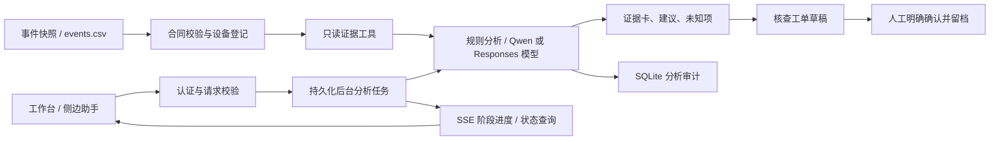

# 伏脉智维运维智能体 V0.2

## 当前交付与适用边界

本分支在现有光伏异常筛查项目上新增可运行的证据助手后端、前端工作台和随页侧边助手。已接入学校 GPUStack 上的 Qwen 模型，未配置模型时使用确定性规则。当前事件数据仍为构造样例，尚未接入真实电站接口；没有设备控制或自动派单接口。

交互闭环：选择事件 → 查询登记证据 → 展示数值与通用核查路径 → 生成核查工单草稿 → 人工填写说明并确认 → SQLite 留档。确认状态为 `confirmed_draft`，不表示外部工单创建成功、现场检查完成或故障确诊。原有前端的复核记录仍保存于浏览器，助手不会将其读取为真实故障标签。

前端 `#agent` 是独立工作台；其他页面右下角可打开侧边助手；事件详情可携带当前样例事件进入助手。对话内容做 HTML 转义；令牌只在页面内存中使用。分析历史在后端按身份隔离。纯静态预览没有后端时，明确切换为本地样例预览，不调用模型、不保存后端审计，工单按钮禁用。

规则模式支持按事件/设备查询、按同群证据不足/共性变化筛选、待复核优先排序和通用核查建议。它不是自由问答大模型；不支持的问题只提供证据范围内的核查路径。模型配置后才启用语义分析。

## 结构与能力



- `agent/core.py`：快照验证、事件工具、版本化通用核查清单、规则分析。
- `agent/model.py`：Qwen Chat Completions 与可选 Responses API 工具调用。只允许 `list_events`、`get_event`、`get_runbook`，最多 3 轮、6 次工具调用。Qwen 整体预算 55 秒，Responses 单次请求 18 秒，无自动重试。严格 JSON 输出、引用必须出自查询结果。模型解释独立标注，确定性证据和未知项始终保留。API 错误或输出校验失败时显式降级。
- `agent/store.py`：追加式分析审计、按拥有者读取、幂等草稿生成和确认。保留快照指纹、筛查版本和工具记录。没有模型写入工具。数据库不是防篡改合规归档，需外部备份与权限控制。
- `agent/tasks.py`：SQLite 后台任务、按身份隔离、请求 UUID 去重、重启后明确标记中断。最多 3 个分析任务同时执行，满载返回 503，不堆积无限队列。
- `agent/server.py`：Python 3.12 标准库 HTTP 服务，仅监听回环地址；nginx 对外代理；同源校验、实测认证、角色校验。普通接口每客户端每分钟 20 请求；状态查询独立限额 120 次；最多 8 条 SSE 进度连接。审计与任务分别最多 10,000 条，达限要求管理员归档。
- `agent/import_snapshot.py`：把已有筛查结果转换为标准快照；校验后原子写入。没有模块导入时下载、训练或连接服务器。

模型通过官方 [Responses 工具调用协议](https://developers.openai.com/api/docs/guides/function-calling) 接入，外部内容按 [智能体安全指南](https://developers.openai.com/api/docs/guides/agent-builder-safety) 作为不可信数据处理。工具白名单限制可执行能力，但不能保证模型解释完全正确，仍需人工核查。

## 数据合同 v1

快照根对象：

| 字段 | 要求 |
|---|---|
| schema_version | 整数 `1` |
| site_id / dataset_version / screening_version | 1–96 字符的字母、数字、下划线、点、冒号或短横线标识 |
| source | `constructed_demo` 或 `measured`，必须与服务模式一致 |
| timezone | IANA 时区；PVDAQ 2107 的本地时间使用 `America/Los_Angeles` |
| observed_at | 最新实际观测时间，ISO 8601，必须带 UTC 偏移；不是上传/生成时间 |
| devices | 明确登记的设备列表，每项 `id`、`peer_group`；1–10,000 台 |
| events | 筛查事件列表，最多 50,000 条；空列表允许 |

事件字段沿用 `src/events.py`：`event_id,inverter,peer_group,start_local,last_sample_local,samples,observed_span_minutes,mean_actual_kw,mean_reference_kw,reference_shortfall_kwh,peer_flag_samples,min_peer_count,mean_peer_gap,evidence,review_status`。

功率 kW，参考电量差 kWh，同群偏离为无量纲比值差。时间为快照声明时区的本地墙上时间，起止跨度必须等于 `(samples-1)*5` 分钟，最少 3 个采样点；功率与电量为有限非负数，日间参考功率 >5 kW。单机候选要求最少 5 个其他同群、至少 3 个同群偏离采样。摘要验证不替代上游对逐点连续性、同群容量/朝向可比性、计量校准、DST 重复墙上时间的检查。DST 重复小时须由上游去歧义或隔离，避免错误合并。

`evidence` 只能为 `device_specific_candidate`、`shared_or_model_candidate`、`insufficient_peers`；均为候选证据，不是故障标签。`review_status` 沿用已有枚举，但助手不会把上游状态自动当作可训练真值。任意上游备注不进入工具结果和模型指令。参考电量差不是可挽回收益。

快照文件最大 32 MiB。一次启动加载为不可变版本，运行时请求不能选择文件路径/URL；更新文件后重启服务加载新版本。距 `observed_at` 超过 15 分钟为过期快照，实测模式仍可回顾证据，但禁止新建或确认草稿。该阈值需结合实际采集延迟评审后再调整。服务每次请求重新计算是否过期。

将项目产出的 `events.csv` 接入（设备登记 JSON 示例：`[{"id":"inv_01","peer_group":"group_A"}, ...]`）：

```bash
python3 -m agent.import_snapshot \
  --events /data/screening/events.csv --devices /data/registry/devices.json \
  --site-id plant_A --dataset-version batch_001 --screening-version screening_v1 \
  --timezone Asia/Shanghai --observed-at '2026-10-19T12:00:00+08:00' \
  --output /var/lib/fumai-agent/snapshot.json
```

时间参数必须替换为来源中的最新观测时间，不能照抄示例。该 CLI 适配项目筛查 CSV，不直接轮询 SCADA/PLC；实时采集连接器需依据真实接口补充。不要通过改 `source` 把样例升级为实测。

## 本地运行与验证

除 Windows 上需要 IANA 时区数据库外，无第三方运行依赖；Linux 使用系统 tzdata。Windows 缺少时区库时安装 `tzdata`。

```bash
python -m unittest discover -s agent/tests -v
node --test frontend/tests/agent-task.test.mjs
AGENT_ORIGIN=http://127.0.0.1:4178 python -m agent.server \
  --port 4178 --snapshot agent/demo-snapshot.json \
  --database /tmp/fumai-local.sqlite --static-root frontend/dist
```

打开 `http://127.0.0.1:4178/#agent`。PowerShell 用 `$env:AGENT_ORIGIN='http://127.0.0.1:4178'` 设置环境变量，再运行 Python 命令。开发静态服务仅白名单文件；部署环境由 nginx 承担。

## 服务器配置与部署

保留其他成员服务与 `/api/` 路由；智能体独占回环 `8091` 和 `/agent-api/`。首次由管理员创建专用无登录账号 `fumai-agent`，建立 `/var/lib/fumai-agent`（归其所有，0700），复制 `ops/fumai-agent.service` 到 systemd，使用 `ops/agent-location.conf` 在现有 server 块内添加代理。检查 8091 未占用、`nginx -t` 成功后 reload。运行目录为 `/srv/fumai-zhiwei/agent/current`；不要运行 PyTorch 训练或本地大模型挤占这台小内存服务器。

`/etc/fumai-agent.env` 仅 root 可读（0600），演练初始配置：

```text
AGENT_MODE=demo
AGENT_ORIGIN=http://your-authorized-host
```

首次演练可复制 `agent/demo-snapshot.json` 到 `/var/lib/fumai-agent/snapshot.json`，归 `fumai-agent` 所有。后续部署不能覆盖已有快照、数据库或环境配置。

模型接入只作用于 `/agent-api/` 运维证据助手，其他业务后端由各模块负责人接入。当前 Qwen 使用学校 GPUStack 的 Chat Completions 接口，服务器配置：

```text
AGENT_MODEL_API=chat_completions
AGENT_BASE_URL=https://ai.wust.edu.cn/gpustack/v1
AGENT_MODEL=Qwen3-30B-A3B-Instruct-2507
AGENT_API_KEY=<服务端密钥>
```

配置示例见根目录 `.env.example`。API 根地址不能附带 `/chat/completions`；适配器自动拼接该路径。密钥只放在 `/etc/fumai-agent.env`（0600），不放进前端、Git 或日志。旧的 `OPENAI_API_KEY` 仍兼容，但优先使用 `AGENT_API_KEY`。本地 `.env.local` 受 Git 忽略；服务本身从进程环境读取，不自动加载 dotenv。

保留原 Responses 配置：

```text
AGENT_MODEL_API=responses
OPENAI_API_KEY=<服务端密钥>
AGENT_MODEL=<可用模型>
AGENT_RESPONSES_URL=https://api.openai.com/v1/responses
```

协议默认 `responses`，避免改变已有部署。必须同时设置密钥与模型，否则启动失败；两者均未配置时使用规则分析。Chat Completions 使用 system/user/assistant/tool 消息进行最多 3 轮、6 次只读工具调用，最后一轮不再提供工具并要求最终 JSON。整体模型处理预算为 55 秒；第三轮仍调用工具、输出截断、非法工具或无法验证的证据引用均降级为规则分析，不当成模型成功。输出字段和证据引用会在后端再次校验，模型不能修改设备、数据快照或确认工单。

### 长任务与前端计时

前端使用以下接口（均保留现有 Origin、X-Fumai-Session 或 Bearer 身份）：

| 接口 | 行为 |
|---|---|
| `POST /agent-api/analysis-tasks` | 提交 `message`、可选 `event_id/device_id` 和 UUID `request_id`，立即返回任务。相同身份、编号、内容的重试复用任务；编号内容冲突拒绝。 |
| `GET /agent-api/analysis-tasks/{task_id}` | 返回状态、阶段、耗时，完成后含完整 `result`。 |
| `GET /agent-api/analysis-tasks/{task_id}/events` | SSE 每秒发送 `progress`，终态发送 `done`；数据为任务对象。 |

状态为 `queued/running/completed/failed`。模型错误会生成带 `model_status=failed_fallback` 的规则结果，任务仍可正常完成；任务执行或存储错误显示失败。SSE 推送的是处理阶段及最终结果，未逐字透传未经校验的模型输出，也不展示虚构百分比。

网页每秒更新计时，不反复重绘输入框；完成后保留总耗时。任务在提交前保存 UUID，避免响应丢失时重复调用模型。刷新同一标签页可通过 sessionStorage 恢复；SSE 断开或达到 60 秒后改为每 2 秒查询，后台任务继续。计时反映等待时间，不代表准确剩余时间；异步处理不改变模型本身生成速度。

服务重启后未完成任务标记为 `failed/interrupted`，需要重新提交，不自动重放可能已计费的请求。任务状态与结果持久化至同一数据库；每个数据库仅运行一个服务实例。nginx 必须关闭 `proxy_buffering` 与 `proxy_cache`，配置见 `ops/agent-location.conf`。旧 `POST /agent-api/analyze` 保留兼容，共用并发限制；新页面不再依赖该同步接口。

模型端点仅由管理员配置，要求 HTTPS，禁止重定向。模型分析成功时返回 `engine=chat_completions`（或 `responses`）、`model_status=connected` 和实际配置模型名；`model_configured=true` 仅说明配置存在，不能代表真实调用成功。输入是当前事件证据与用户问题；当前部署使用构造样例，尚未接入真实电站采集系统。

实测模式另需：

```text
AGENT_MODE=live
AGENT_ORIGIN=https://your-plant-domain.example
AGENT_USERS_JSON={"<至少32字符的独立随机令牌>":{"id":"engineer_01","role":"operator"},"<另一独立随机令牌>":{"id":"reviewer_01","role":"viewer"}}
```

systemd EnvironmentFile 中 JSON 值应用单引号包住，保留内部双引号。`viewer` 可查询分析；`operator` 可生成和确认草稿。身份 id 必须唯一分配。当前是单站点接入，尚无 SSO、令牌到期、租户隔离或双人审批；令牌轮换需改服务器配置并重启。生产试运行前应按团队身份系统替换/接入此层，不能给所有人共享一个 operator 令牌。nginx 必须覆盖 `X-Forwarded-Proto`，后端不得暴露公网端口。

安装 `/srv/fumai-zhiwei/ops/deploy_agent.py` 和已有 `deploy_frontend.py` 后：

```bash
python3 /srv/fumai-zhiwei/ops/deploy_agent.py --commit <完整40位已推送提交SHA>
```

下载精确提交、限制并检查归档路径、运行后端单测、原子切换智能体版本、systemd 重启、核对后端版本，再用已有流程部署前端。失败恢复代码版本；配置/快照/审计持久保留。当前表结构为初版，未来涉及破坏性数据库变更时必须另做迁移、备份及恢复演练，不能依赖代码回退恢复数据。

检查 `/agent-api/health` 与 `/deployment.json` 提交一致，再验证分析、证据卡和人工确认。health 的 `model_configured` 只表示配置存在，不表示模型请求成功；只有真实请求返回 `model_status=connected` 且含通过校验的 `model_analysis` 才算该次调用成功。没有密钥时不能声称模型联调通过。

## 工业现场试运行前仍需完成

当前完成的是可接入工程基础和演练闭环。实际投运需由团队验收真实数据时序/单位/同群关系，故障与检修真值、站点规程与责任人，模型账号和延迟/费用预算，HTTPS与身份管理、网络边界、备份恢复、日志访问/留存和告警监控。使用经过标注的现场事件评估漏报/误报及建议有效性，保留人工复核记录；不能把研究数据集分数当作现场准确率。

本版无电气设备执行器、无自学习训练任务、无自动确认故障路径。后续工单对接需有幂等、工单状态回传、授权和失败补偿；任何设备控制必须是另外评审的系统能力。
