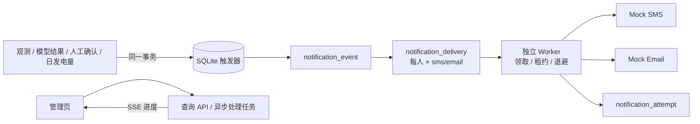
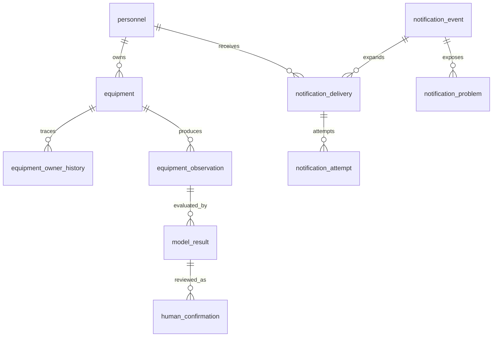

# 数据库事件与短信、邮件通知

本目录实现 N1–N6 的 SQLite + mock 闭环，并为 N7 提供 `frontend/dist/notifications.html` 管理页。默认 `FUMAI_NOTIFICATION_MODE=mock`，只记录模拟发送，不访问短信或邮件服务商。

## 架构与边界



SQLite 是本次比赛交付的明确数据库引擎。触发器只写库，不访问外网；业务事务回滚时事件与 delivery 一起回滚。`notification_event.dedupe_key` 和 `UNIQUE(event_id, recipient_id, channel)` 是业务幂等边界。

模型 anomaly 的文案固定为“疑似异常”。只有独立的 `human_confirmation` 记录为 `confirmed_fault` 且原模型结果 `quality_status=ready` 时，才生成“人工确认故障”事件。`uncertain`、`blocked`、缺失质量不会被触发器发成确认故障。

当前项目只有运行异常检测，没有真实日发电量预测服务。API 只接受明确标注的测试预测值，通知正文显示“模拟预测值”。不能把异常分数写入 `forecast_kwh`。

## 表关系



`equipment_observation` 使用 `(equipment_id, observed_at)` 唯一约束，时间为带时区的 ISO 8601。日发电量使用 `(plant_id, local_date, revision)` 唯一约束，`0 kWh` 与 `NULL` 含义不同。负责人通过 `equipment.owner_id` 表达，一人可负责多台设备；变更由触发器写入历史表。

## 触发和修订策略

- 模型事件用 `equipment + incident_key + state_level` 去重。服务默认将 30 分钟冷却窗口内、同设备、同疑似类别的异常归到同一 `incident_key`；相同等级不重复通知，明确升级等级可通知一次。
- 人工确认用 `equipment + incident_key + confirmed` 去重，不覆写模型原始结果。
- 每日发电 INSERT 和 UPDATE 都检查双值齐备。实际先到、预测先到都能触发；同一修订版本只触发一次。
- 新修订版本会补发一轮，并在事实快照和消息中注明修订版。重复写同一版本不补发。
- 事件创建时固定启用收件人、渠道和地址快照。后续人员联系方式变化只影响新事件。
- 负责人缺失、负责人停用、手机或邮箱缺失/非法会产生 `notification_problem` 或 `needs_attention`，管理页可见。

## 本地 mock 验收

需要 Node.js 24 或以上，使用 Node 内置 `node:sqlite`，无需 npm 安装第三方依赖。

```bash
cd notifications
npm run check
npm test
npm run migrate
npm run serve
```

打开 `http://127.0.0.1:8787/notifications.html`。点击“异步处理待发送任务”会创建持久化 `async_task`，HTTP 立即返回 202，页面通过 SSE 显示进度。也可独立运行 Worker：

```bash
npm run worker
node src/run-worker.mjs --once
```

## API 冻结契约

| 方法 | 路径 | 行为 |
| --- | --- | --- |
| GET/POST | `/api/personnel` | 人员列表；手机号、邮箱格式校验并返回缺失警告 |
| GET/POST | `/api/equipment` | 设备列表；负责人选择与变更历史 |
| POST | `/api/observations` | 写入设备唯一时刻观测 |
| POST | `/api/model-results` | 写入模型原始结果；触发器按质量与事件键生成通知 |
| POST | `/api/human-confirmations` | 追加人工确认，不覆盖模型结果 |
| POST | `/api/daily-generation` | 写入实际/测试预测电量，双值就绪触发 |
| GET | `/api/notifications/events` | 通知事件列表与聚合状态 |
| GET | `/api/notifications/events/:id` | 事实快照、每位人员双渠道状态、尝试历史与问题 |
| POST | `/api/notifications/deliveries/:id/retry` | 仅管理员重试确定失败项，写操作审计 |
| POST | `/api/notification-jobs` | 创建异步 Worker drain 任务 |
| GET | `/api/notification-jobs/:id/events` | SSE 流式任务进度 |

管理写接口要求 `X-Fumai-Role: admin` 和 `X-Fumai-Actor`。这是比赛 mock 的最小权限契约，生产环境需由统一认证网关注入可信身份，不能信任浏览器自报角色。

## Worker 可靠性

Worker 用 `BEGIN IMMEDIATE` 原子领取任务，限制并发并设置租约。进程崩溃后，过期 `processing` 会恢复为 `retry_wait`。临时失败采用指数退避并限制最大次数；短信和邮件各自完成，成功渠道不会因另一渠道失败而重发。

服务商超时且无法判断是否已接收时进入 `verify_pending`，人工重试接口会拒绝直接重试。真实适配器必须先调用服务商查询接口核验，再决定记账或重发。数据库幂等不能保证外部短信严格只发一次。

## 迁移、部署与回退

`src/db.mjs` 启动时幂等执行 `migrations/001_notifications.sql`。空库可重复重放。部署时分别运行 API 和 Worker，systemd 示例在 `ops/`；生产数据库文件应放持久磁盘并定期备份。

回退前先停 API 与 Worker并备份数据库，再执行 `migrations/001_notifications.down.sql`。该脚本会删除本模块全部表和审计记录，仅适用于确认不再需要数据的回退；已有数据环境优先做前向迁移。

真实短信签名、模板、邮件服务商和密钥尚未提供，因此 `UnconfiguredRealProvider` 会明确失败。接入时实现与 `MockProvider.send/lookup` 相同的接口，把密钥放服务器 secret 配置，日志只记错误码和脱敏信息。发出任何真实测试消息前仍需团队明确授权。

