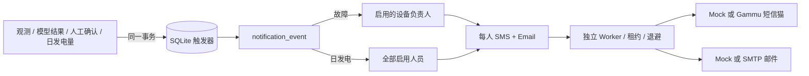

# 数据库事件、登录与双渠道通知

本目录实现 SQLite 事务性通知、网站多用户登录、SMTP 邮件和 Gammu 短信猫适配器。默认两个渠道都是 `mock`，配置真实服务商前不会发送外部消息。

## 业务流程



故障通知包含 `model_anomaly`（疑似异常）和 `confirmed_fault`（人工确认故障），日发电通知为 `daily_generation_ready`。接口和管理页可按 `fault`、`daily` 分开查询。`notification_event.dedupe_key` 与 `UNIQUE(event_id, recipient_id, channel)` 防止业务任务重复展开。

模型 anomaly 始终写成“疑似异常”。只有人工确认且模型质量为 `ready` 时才生成确认故障事件。`uncertain`、`blocked` 和缺失数据不会被写成确认故障。当前日发电预测仍是明确标注的测试值，不能用异常分数代替预测电量。

## 数据库与登录

SQLite 迁移包含人员、设备、观测、模型结果、日发电、通知事件、双渠道 delivery、尝试历史、问题记录、操作审计，以及：

- `app_user`：用户名、显示名称、角色、启用状态和 scrypt 密码哈希；
- `auth_session`：只保存会话令牌的 SHA-256 哈希和过期时间；
- 浏览器只接收 `HttpOnly; SameSite=Lax` Cookie，前端不能读取令牌；
- 角色分为 `admin`、`operator`、`viewer`，后端逐接口校验权限；
- 登录按 IP + 用户名限制连续失败次数。

首次启动时，在服务器私密环境文件中设置 `FUMAI_BOOTSTRAP_ADMIN_USERNAME` 和 `FUMAI_BOOTSTRAP_ADMIN_PASSWORD`。只有用户表为空时才创建该管理员。创建后可删除这两个变量。

## 真实邮件与短信猫

邮件适配器使用 SMTP implicit TLS（通常为 465 端口），支持 AUTH LOGIN。服务器环境配置示例：

```dotenv
FUMAI_EMAIL_PROVIDER=smtp
FUMAI_SMTP_HOST=smtp.example.com
FUMAI_SMTP_PORT=465
FUMAI_SMTP_SECURE=true
FUMAI_SMTP_USER=noreply@example.com
FUMAI_SMTP_PASSWORD=server-secret-only
FUMAI_SMTP_FROM=伏脉智维 <noreply@example.com>
```

短信猫适配器通过参数数组调用 `gammu-smsd-inject`，避免 shell 拼接。先在服务器安装并配置 Gammu，让系统用户 `fumai-notify` 有权连接 USB/串口设备：

```dotenv
FUMAI_SMS_PROVIDER=gammu
FUMAI_GAMMU_COMMAND=/usr/bin/gammu-smsd-inject
FUMAI_GAMMU_CONFIG=/etc/gammu-smsdrc
```

邮件与短信模式独立，例如可以先启用 SMTP，短信继续 mock。账号授权码、邮箱密码和短信猫配置不进入 Git。服务商超时且接收状态未知时进入 `verify_pending`，不会直接重复发送。

## 本地验收

需要 Node.js 24 或以上，项目只使用 Node 内置模块。

```bash
cd notifications
npm run check
npm test
npm run migrate
FUMAI_BOOTSTRAP_ADMIN_USERNAME=admin \
FUMAI_BOOTSTRAP_ADMIN_PASSWORD='replace-with-a-long-password' \
npm run serve
```

打开 `http://127.0.0.1:8787/login.html`。登录后首页和 `/notifications.html` 都会校验数据库会话。通知中心提供网站账号、人员联系方式、设备负责人、故障通知、日发电通知和每个渠道的发送状态。

## 主要 API

| 方法 | 路径 | 最低角色与行为 |
| --- | --- | --- |
| POST | `/api/auth/login` | 公开登录，成功写 HttpOnly Cookie |
| GET | `/api/auth/me` | 已登录用户信息 |
| GET/POST | `/api/users` | 管理员查询或保存网站账号 |
| GET/POST | `/api/personnel` | 登录查看；管理员保存手机和邮箱 |
| GET/POST | `/api/equipment` | 登录查看；管理员分配负责人 |
| POST | `/api/observations`、`/api/model-results`、`/api/daily-generation` | 操作员及以上写入业务数据 |
| POST | `/api/human-confirmations` | 管理员追加人工确认 |
| GET | `/api/notifications/events?category=fault|daily|all` | 登录后按类别查询通知 |
| GET | `/api/notifications/events/:id` | 事件、收件人、双渠道状态、尝试与问题 |
| POST | `/api/notifications/deliveries/:id/retry` | 管理员人工重试确定失败项并审计 |
| POST | `/api/notification-jobs` | 管理员创建异步发送任务 |
| GET | `/api/notification-jobs/:id/events` | Cookie 鉴权的 SSE 进度流 |

## Worker 与部署

Worker 用 `BEGIN IMMEDIATE` 原子领取任务，设置有限并发和租约。崩溃后的过期租约会恢复，临时错误指数退避，短信和邮件互不连带重发。数据库只能保证业务任务幂等，不能保证外部服务商严格只发送一次。

`ops/deploy_server.sh` 创建隔离服务用户、持久数据库目录、systemd API/Worker 服务和 Nginx 路由。部署脚本会保留 `/etc/fumai-notifications.env` 中已有的账号与服务商密钥，只更新发布路径等受管配置。回退前先停 API 与 Worker并备份数据库；`001_notifications.down.sql` 会删除本模块全部表，仅适用于确认不再需要数据的完整回退。
